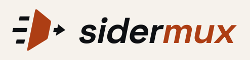
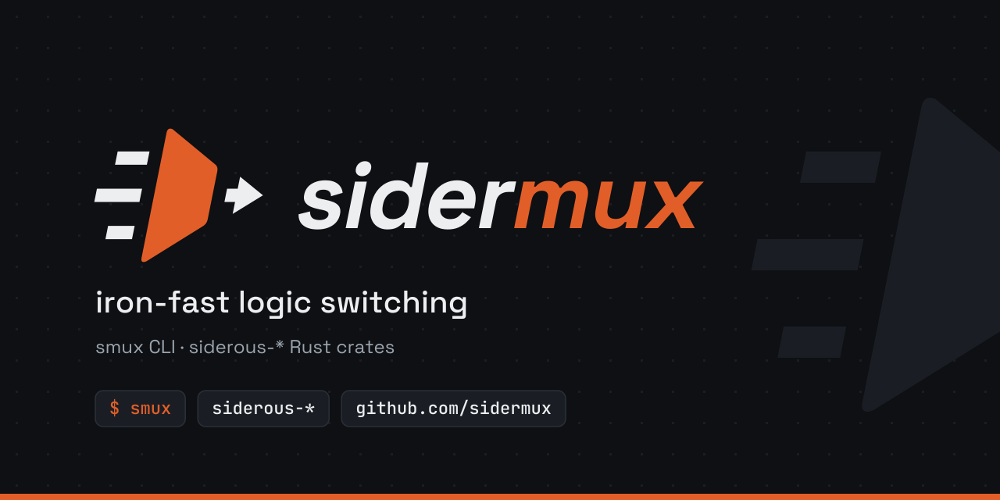

# sidermux-assets

Brand assets for sidermux, as SVG.

| Preview | File | Description |
| --- | --- | --- |
|  | `icons/icon.svg` | App icon, dark tile |
|  | `icons/icon-light-tile.svg` | App icon, light tile |
|  | `icons/icon-transparent.svg` | Icon for dark backgrounds |
|  | `icons/icon-light.svg` | Icon for light backgrounds |
|  | `logos/logo-horizontal.svg` | Horizontal logo |
|  | `logos/logo-horizontal-light.svg` | Horizontal logo, light |
|  | `wordmarks/wordmark.svg` | Wordmark |
|  | `wordmarks/wordmark-light.svg` | Wordmark, light |
|  | `social/og-1280x640.svg` | Social card (1280×640) |

Variants without a suffix are for dark surfaces. `-light` variants are for light surfaces.

## License

Dual licensed under [MIT](LICENSE-MIT) or [Apache-2.0](LICENSE-APACHE).
